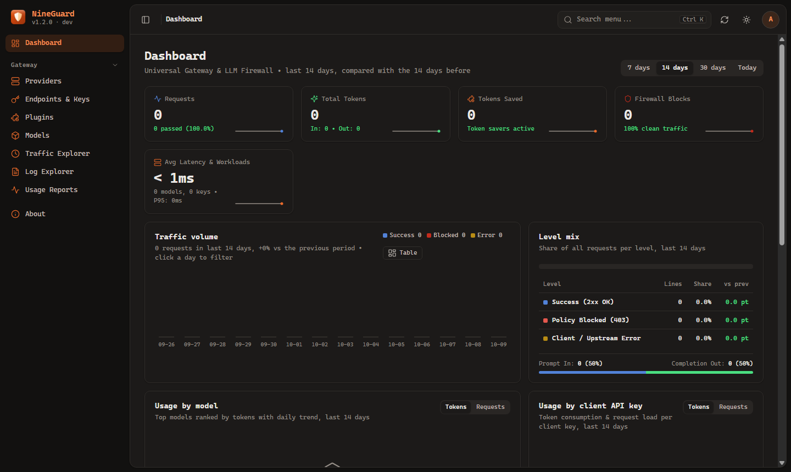
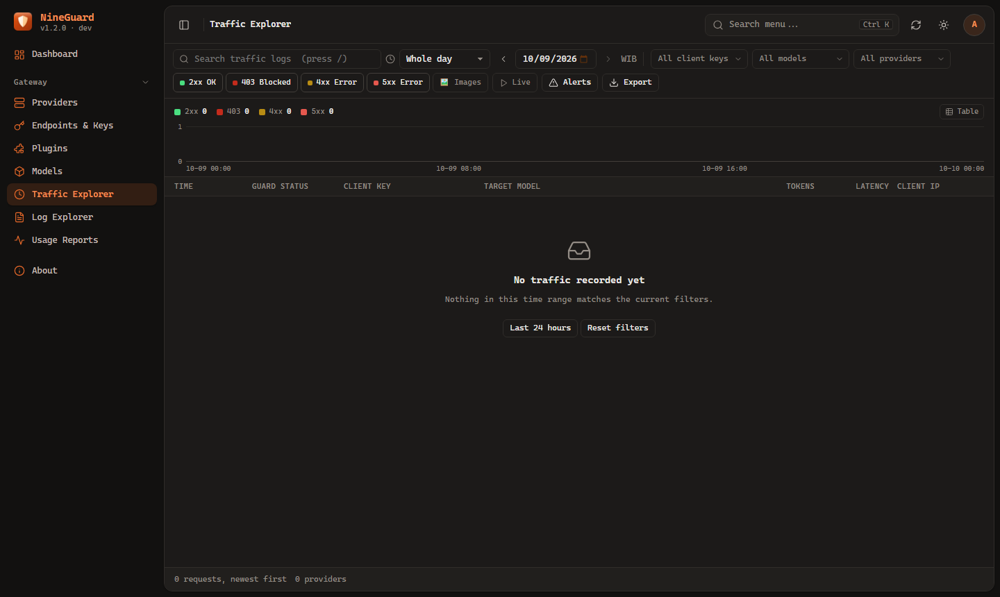
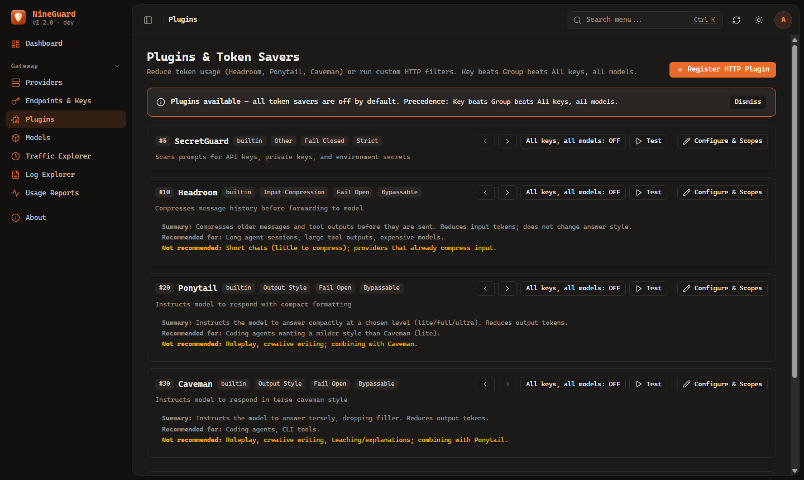
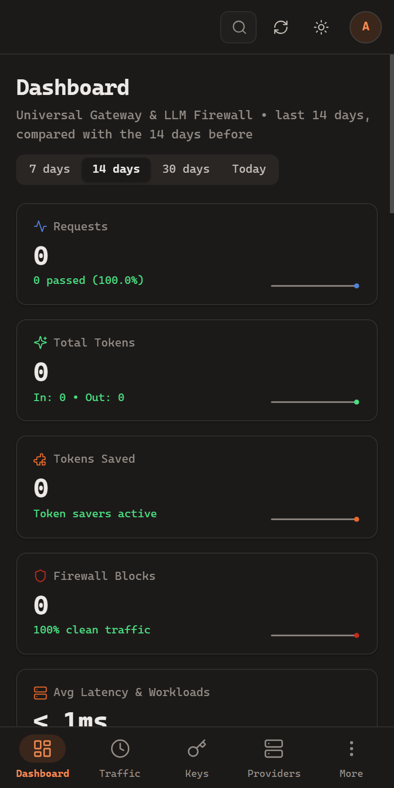
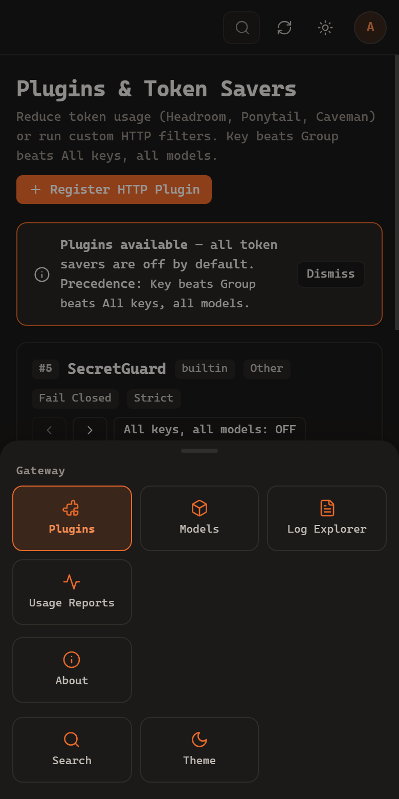
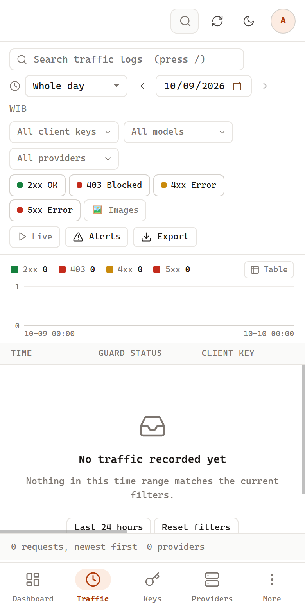

<div align="center">


# NineGuard

**Universal OpenAI-Compatible Gateway, Model Firewall & Multi-Provider Router**

NineGuard is a high-performance reverse proxy and intelligent firewall designed to secure, group, and track LLM usage across OpenAI-compatible providers without changing client application code.

[](https://go.dev)
[](https://www.docker.com)
[](https://modernc.org/sqlite)
[](LICENSE)

<p align="center">
  <b>English</b> &bull;
  <a href="README.id.md">Bahasa Indonesia</a>
</p>

</div>

---

## Overview

In modern AI engineering ecosystems, teams and developers frequently consume LLMs across diverse OpenAI-compatible providers (such as 9router, OpenRouter, vLLM, local Ollama, LiteLLM, etc.). However, several operational challenges arise:

1. **Model & Quota Leaks** — Models intended to be disabled or restricted remain accessible if a client knows or manually enters the model ID.
2. **Absence of Client API Key Governance** — Clients and agents connect directly with master upstream provider keys, making it difficult to trace which developer or agent consumed the quota.
3. **Multi-Provider Fragmentation** — Routing different agents across distinct providers requires repeated, error-prone reconfiguration in each development environment.

**NineGuard resolves these challenges as a Unified Gateway:**
* **Strict Gatekeeper** — Clients (Cursor, Cline, Pi, custom scripts) authenticate using dedicated NineGuard API keys (`sk-ng-...`). Requests without a valid key are instantly rejected with HTTP 401 Unauthorized.
* **Prefix Multi-Provider Routing** — Register upstream providers with custom routing prefixes (e.g. `openrouter`, `local`, `ollama`). NineGuard aggregates models into prefixed identifiers like `openrouter/claude-3.5-sonnet` and automatically strips the prefix when forwarding requests to the target provider.
* **Per-Key Model Access Control** — Restrict accessible models per API key (custom whitelist, dynamic Model Groups, or global wildcard `*`). Requests for unlisted models are blocked immediately (HTTP 403 Forbidden).
* **Permanent Model Firewall** — Intercept requests before they hit upstream endpoints. Disabled models are blocked on the spot with HTTP 403 Forbidden.
* **Accurate Token Audit & Telemetry** — Captures request metadata, client key name, model ID, prompt tokens, completion tokens, latency, and client IP address in embedded SQLite.
* **Zero-Latency Transparent Streaming** — Server-Sent Events (SSE) responses are flushed instantly back to the client.
* **Pure Dependency-Free Single Binary** — Built with pure Go (`CGO_ENABLED=0`) and a Vanilla JS single-page frontend embedded directly into the binary.
* **Upstream Quota Tracking & Cascaded Gateways (v1.4.0)** — Live visibility into upstream capacities and rolling limits (e.g. 5-hour rolling windows and weekly allowances in 9router, prepaid balances) as well as cascaded NineGuard gateways (*Office -> VM -> Local*).
* **Direct Chat Commands (`/quota`, `/limits`, `/usage`)** — Inspect remaining key allowances and upstream capacity directly from within Cursor/Cline/Pi/IDE chat windows without leaving the workspace, consuming 0 upstream tokens.
* **Developer Self-Service Portal (`/portal`)** — Browser-accessible key portal where developers authenticate with their API key to inspect remaining quotas, reset schedules, activity heatmaps, and allowed models without needing admin credentials.
* **Secret Vault (AES-256-GCM Encryption-at-Rest)** — All upstream API keys, passwords, and secrets are encrypted at rest in SQLite using authenticated AES-256-GCM.
* **Anti-Recursion Loop Guard** — `X-NineGuard-Trace` header and hop counters detect and block cyclic loops between cascaded gateways with HTTP 508 Loop Detected.

---

## Screenshots

### Web (Desktop)

| Dashboard | Traffic Explorer |
| --- | --- |
|  |  |



### Mobile

On displays ≤ 860px, the sidebar is replaced by **Bottom Navigation**: Dashboard, Traffic, Keys, Providers, and **More** (sheet containing additional views, Search, and Theme toggle).

| Dashboard | Plugins + More Menu | Light Theme |
| --- | --- | --- |
|  |  |  |

---

## Architecture: How NineGuard Works

NineGuard acts as a unified gateway between AI Coding Agents and Upstream Providers:

```text
┌─────────────────────────────────────────────────────────────┐
│  AI Coding Agent (Cursor / Cline / Continue / Pi / Python)  │
└──────────────────────────────┬──────────────────────────────┘
                               │  Base URL: http://localhost:8080/v1
                               │  Header: Authorization: Bearer sk-ng-...
                               ▼
┌─────────────────────────────────────────────────────────────┐
│  NineGuard Gateway (:8080)                                  │
│  ┌───────────────────────────────────────────────────────┐  │
│  │ 1. Gatekeeper: Validate NineGuard Client API Key      │  │
│  │    • Invalid? ──► Reject (HTTP 401 Unauthorized)      │  │
│  │ 2. Firewall & Access Control: Check Model Permission  │  │
│  │    • Unauthorized? ──► Block (HTTP 403 Forbidden)     │  │
│  │ 3. Prefix Router: Route Provider by Model Prefix      │  │
│  │    (e.g., openrouter/... or local/..)                 │  │
│  │ 4. Telemetry: Record Logs, Latency, & Token Usage     │  │
│  └───────────────────────────────────────────────────────┘  │
└──────────────────────────────┬──────────────────────────────┘
                               │  Upstream Master API Key Injection
                               ▼
┌─────────────────────────────────────────────────────────────┐
│  Upstream OpenAI-Compatible Providers                       │
│  ├── Provider A (openrouter): https://openrouter.ai/api/v1  │
│  ├── Provider B (local):      http://localhost:11434        │
│  └── Provider C:              https://api.openai.com/v1     │
└─────────────────────────────────────────────────────────────┘
```

---

## Key Features

| Feature | Description |
|---|---|
| **Multi-Provider Routing** | Register upstream OpenAI-compatible routes and namespace models with custom prefixes (e.g. `openrouter/model-id`). |
| **Dual-Header & Anthropic Messages** | Native Anthropic `/v1/messages` protocol support alongside OpenAI `/v1/chat/completions`. Single unified `sk-ng-...` API key works across both `Authorization: Bearer` and Anthropic `x-api-key` headers with zero translation loss for extended thinking and prompt caching. |
| **Client Key Management** | Issue and revoke scoped NineGuard API keys (`sk-ng-...`) to track consumption per agent. |
| **Per-Key Model Access Control** | Enforce model permissions per API key (global wildcard `*`, dynamic Model Groups, or manual whitelist). |
| **Model Groups** | Organize models into reusable groups (e.g. GPT Ecosystem, Claude) with dynamic synchronization to associated keys. |
| **Model Firewall** | Enable/disable models instantly with HTTP 403 Forbidden enforcement. |
| **Key Quotas & Rate Limiting** | Impose token budgets per API key (daily, weekly, monthly, lifetime) with soft post-facto gating, standard HTTP 429 responses, `Retry-After` headers (except lifetime quotas which never reset), and reset countdowns. Choose when quotas reset (timezone, time of day, weekday, day of month) globally or per key; changing it keeps current usage. |
| **Model Quotas (Per Model)** | Alternative to Key Quota: keys can have individual token ceilings for specific models (e.g. `openai/gpt-4o` 50k/day, `anthropic/claude-sonnet` 1M/month). A key uses one mode at a time without losing settings of the inactive mode. When depleted, HTTP 429 `model_quota_exceeded` blocks only that specific model. |
| **Quotas View & Alerts** | Dedicated **Quotas** view displaying usage across all keys and models (filterable by mode/status), "Quotas near limit" cards on the Dashboard, and inline quota status in the keys table. Alert threshold configured via `quota_warn_percent` (default 80%). |
| **Token Burn Velocity & Presets** | Monitor historical consumption velocity (24 hours, 7-day average, 30 days) per key to guide quota sizing with 1-click preset buttons (1.5x / 2x average) matching the selected reset period (daily, weekly, monthly). |
| **Plugin Pipeline & Token Savers** | Trim tokens and modify requests automatically via built-in plugins (Headroom, Ponytail, Caveman) or external HTTP webhooks with global pipeline ordering and hierarchical overrides (Global $\rightarrow$ Model Group $\rightarrow$ API Key). |
| **Secret Leak Guardrail (SecretGuard)** | Prevent leakage of API tokens (`sk-`, `ghp-`, `AKIA`), private keys, and environment secrets into upstream LLM prompts with regex inspection (Block HTTP 403, Redact in-flight, or Audit mode). |
| **Traffic Spike Alerts** | Flag oversized requests exceeding thresholds (`heavy_token_threshold`) with ⚠️ warning badges in Traffic Explorer and audit logs without dropping the connection. |
| **Multimodal Image Logging** | Detect and track requests containing image/vision payloads in chat history with `🖼️ N img` badges and search filters. |
| **Payload Inspector & Request Replay** | Inspect request and response bodies (512KB limit, 7-day auto-purge), copy 1-click cURL commands, and replay requests directly from the dashboard. |
| **Auto & Manual Model Fetch** | Pull live model catalogs from all active upstream providers and aggregate them into a centralized view. |
| **Interactive Trend Charts** | Visualize request throughput, token volume, and response latencies with interactive time-series charts. |
| **Usage Reports & Breakdown** | Audit "who is consuming what" with preset timeframes (Today, 7D, 30D, Month, Last Month) and Custom Date Ranges. |
| **Traffic Explorer** | High-density real-time request logs with key name, model ID, HTTP status filters, and live tail mode. |
| **System Log & Audit Explorer** | Monitor internal gateway runtime logs, SQLite rotation, component source filters, and security RBAC audits. |
| **Interactive TUI & System Tray** | Terminal user interface with live logs and background controls, plus system tray support on Windows/macOS/Linux. |
| **Agent Setup Guides** | Ready-to-copy setup instructions for Cursor IDE, Cline, Continue.dev, Pi Agent, Python, Node.js, and cURL. |

---

## Installation & Running

### Option 1: Using Go Binary (Linux & macOS)

NineGuard supports 2 target deployment profiles:
1. **Desktop Environment / Window Manager (Linux GUI, macOS):**
   - Integrates with the **System Tray** notification area (KDE Plasma, GNOME, XFCE, i3, Sway, Hyprland, etc.).
   - TUI menu includes: **`Hide to Tray (Background)`**.
   - Uses CGO to communicate with display servers and StatusNotifierItem.
2. **Linux Server / Headless Environment:**
   - Pure Go single binary without GUI or CGO dependencies (`CGO_ENABLED=0`, `-tags server`).
   - No tray needed; operates as a **Background Daemon Process** detached from terminal/SSH sessions.
   - TUI menu automatically adapts to show: **`Run in Background (Daemon)`**.
   - If invoked with `-t / --tray` on headless servers, NineGuard safely falls back to background daemon mode without crashing.

```bash
# 1. Enter NineGuard project directory
cd nineguard

# 2. Build according to your environment:
# Option A: Automatic detection (Desktop GUI if display manager found, otherwise Server)
make build

# Option B: Explicit Desktop build (with System Tray support)
make build-desktop

# Option C: Explicit Linux Server build (Headless Daemon, pure Go without CGO/GTK)
make build-server

# Option D: Build all deployment targets at once (nineguard, nineguard-server, nineguard.exe)
make build-all

# 3. Start NineGuard
./nineguard
```

#### CLI & Background Execution Modes (Linux / Server)

| Command | Mode | Description |
|---|---|---|
| `./nineguard` | **Interactive TUI** | Launches interactive terminal interface with status summaries, browser shortcuts, and background actions. Automatically adapts between Desktop tray and Server daemon modes. |
| `./nineguard -d` / `--daemon` | **Headless Daemon** | Runs in the background without terminal UI (suitable for systemd, Docker, or background server tasks). |
| `./nineguard -t` / `--tray` | **System Tray / Daemon** | Minimizes to system tray if GUI session exists; safely falls back to background daemon on headless servers. |
| `./nineguard -l` / `--logs` | **Live Stream Logs** | Starts server and streams HTTP request logs directly to the terminal. |
| `./nineguard -p 9090` | **Custom Port** | Overrides HTTP server listening port (default: `8080`). |

Open your browser at **`http://localhost:8080/`**. On your first visit, set up your administrator credentials.

---

### Option 2: Build & Run on Windows

NineGuard is engineered as a standalone single binary with pure Go SQLite (`modernc.org/sqlite`). You **do not need a C compiler (CGO / MinGW / GCC)** to compile on Windows.

#### 1. Native Windows Build (PowerShell / Command Prompt)

Ensure Go 1.22+ is installed on your Windows machine:

```powershell
# 1. Enter NineGuard directory
cd nineguard

# 2. Build executable binary
go build -o nineguard.exe cmd/nineguard/main.go

# 3. Run NineGuard (Interactive TUI Menu)
.\nineguard.exe
```

> **Tip (Background / System Tray Mode Without Terminal Window):**
> To run NineGuard in the background directly inside the System Tray without keeping a black Command Prompt window open, pass the `-H=windowsgui` linker flag:
> ```powershell
> go build -ldflags="-H=windowsgui" -o nineguard.exe cmd/nineguard/main.go
> .\nineguard.exe -t
> ```

#### 2. Cross-Compile for Windows from Linux / macOS

You can cross-compile the Windows `.exe` directly from Linux or macOS:

```bash
# Console / Interactive TUI mode
GOOS=windows GOARCH=amd64 go build -o nineguard.exe cmd/nineguard/main.go

# GUI / System Tray mode (no console window popup)
GOOS=windows GOARCH=amd64 go build -ldflags="-H=windowsgui" -o nineguard.exe cmd/nineguard/main.go
```

#### 3. CLI Execution Modes on Windows

| Command | Mode | Description |
|---|---|---|
| `.\nineguard.exe` | **Interactive TUI** | Terminal user interface with status cards, browser launcher, and live request log viewer. |
| `.\nineguard.exe -t` / `--tray` | **System Tray** | Runs in Windows system tray. Click the NineGuard icon to open dashboard or exit. |
| `.\nineguard.exe -l` / `--logs` | **Live Logs** | Starts server and streams HTTP/traffic logs directly in console. |
| `.\nineguard.exe -d` / `--daemon` | **Headless / Service** | Background mode without terminal UI (suitable for Task Scheduler or Windows Service). |
| `.\nineguard.exe -p 9090` | **Custom Port** | Overrides HTTP listen port (default: `8080`). |

---

### Option 3: Using Docker

#### Option A: Using Official GHCR Image
```bash
# Pull latest or specific tag
docker pull ghcr.io/darktama/nineguard:latest

# Run container
docker run -d \
  --name nineguard \
  --restart unless-stopped \
  -p 127.0.0.1:8080:8080 \
  -v nineguard-data:/data \
  ghcr.io/darktama/nineguard:latest

# Check installed version
docker exec nineguard /app/nineguard --version
```

#### Option B: Build Local Docker Image
```bash
# 1. Build Docker image with git metadata
make build-docker
# or via script: ./scripts/build.sh docker

# 2. Run container (bound to localhost only)
docker run -d \
  --name nineguard \
  --restart unless-stopped \
  -p 127.0.0.1:8080:8080 \
  -v nineguard-data:/data \
  nineguard:latest
```

#### Docker Compose (NineGuard + 9router Stack)

```bash
# 1. Prepare environment variables
cp .env.example .env
# Fill in NINEROUTER_* secrets (generate: openssl rand -hex 32)

# 2. Start stack
docker compose up -d --build

# 3. Access from local machine via SSH tunnel
ssh -L 8080:localhost:8080 -L 20128:localhost:20128 user@VM_IP
```

* NineGuard: `http://localhost:8080/` (set up admin account on first visit).
* 9router: `http://localhost:20128/dashboard` — issue your API keys here.
* Register 9router in NineGuard (**Gateway → Providers**) using `http://9router:20128/v1` and the 9router API key.
* Both services bind strictly to `127.0.0.1`. For remote public access, place them behind a TLS reverse proxy (Caddy/Nginx).

---

## Environment Variables

The `.env` file is loaded automatically on startup. Only ports, authentication toggles, and data paths are configured via environment:

| Variable | Default | Description |
|---|---|---|
| `NINEGUARD_PORT` | `8080` | HTTP server listening port |
| `NINEGUARD_AUTH_ENABLED` | `true` | Dashboard authentication requirement (`true`/`false`) |
| `NINEGUARD_DB_FILE` | `./data/nineguard.db` | Local SQLite database file path |
| `NINEGUARD_AUTH_FILE` | `./data/auth.json` | Fallback authentication file path (optional) |
| `NINEGUARD_ENCRYPTION_KEY` | *(Auto-generated)* | AES-256 master key (32 bytes / 64 hex characters) for Secret Vault. If empty, NineGuard generates and persists a key at `data/.master.key` (mode 0600). |

*Note: Upstream providers are managed dynamically through the Web UI (Providers view) and persisted in SQLite; target URLs do not need to be hardcoded in `.env`.*

---

## Quick Setup Guide

> **Important Note on Dashboard Navigation:**
> Action buttons for generating API keys, registering providers, and toggling models are **not located on the Dashboard overview page (`#/dashboard`)**. The **Dashboard** is strictly reserved for observability (KPI metric cards, request volume charts, token breakdown, and error inspection). System configuration resides under the **Gateway** menu section in the sidebar:
> * Provider Registration: **Gateway $\rightarrow$ Providers**
> * API Key Generation & Scopes: **Gateway $\rightarrow$ Endpoints & Keys**
> * Model Firewall & Sync: **Gateway $\rightarrow$ Models**
> * Telemetry & Logs: **Gateway $\rightarrow$ Traffic Explorer**, **Log Explorer**, & **Usage Reports**

---

### 1. Register an Upstream Provider
Navigate to **Gateway $\rightarrow$ Providers**:
1. Click **`+ Add Provider`** (located at top-right or inside the empty state card).
2. Complete the dialog form:
   * **Provider Name:** Provider display name (e.g. `OpenRouter Cloud` or `Local Ollama`).
   * **Model Routing Prefix:** Routing prefix (e.g. `openrouter` or `local`). Leave blank to use as root provider.
   * **Route / Target URL:** OpenAI-compatible base URL (e.g. `https://openrouter.ai/api/v1` or `http://localhost:11434`).
   * **Upstream API Key:** Master API key for the provider (leave empty for local unauthenticated models).
   * **Set as Default Provider:** Check this box if you want this provider to act as fallback for unprefixed model requests.
3. Click **`Add Provider`** to save.
4. Click **`Test Probe`** on the new provider card to verify connectivity. A green checkmark with response latency confirms success.

---

### 2. Generate a NineGuard API Key for Agents
Navigate to **Gateway $\rightarrow$ Endpoints & Keys**:
1. On the **NineGuard Client API Keys** card, click **`+ Generate New Key`**.
2. Complete the modal form:
   * **Key Name / Description:** Agent or developer identifier (e.g. `Cursor IDE`, `Cline Mac`, or `Pi Agent`). This label is tagged across all logs and reports.
   * **Allowed Models (Access Control):** Choose one of three access modes:
     * **All Models (Global):** Grants access to all models permitted by the global firewall. New models added later are available immediately.
     * **Model Groups:** Links key to one or more dynamic Model Groups (e.g. *OpenAI Models* or *Claude*). Automatically synchronizes when group members change.
     * **Custom Selection:** Explicit checklist selection or custom model patterns/wildcards (e.g. `openrouter/*`).
3. Click **`Generate Key`**.
4. The **NineGuard API Key Generated** dialog displays the new token (`sk-ng-...`).
5. Click **`Copy Key`** to copy to clipboard.
   > **Security Note:** The full token is only shown once at creation time. Store it securely; NineGuard only stores a cryptographic hash in SQLite.

---

### 3. Model Synchronization & Testing (Recommended)
* **Fetch Live Models:**
  Go to **Gateway $\rightarrow$ Models**, then click **`Fetch from Providers`** at the top right to query and synchronize model catalogs from all active providers.
* **In-Browser Endpoint Tester:**
  Go to **Gateway $\rightarrow$ Endpoints & Keys**, scroll down to the **Live Endpoint Tester**, select your model and key, enter a test prompt, and click **Send Test Request** to verify streaming before configuring external agents.

---

### 4. Configure Your AI Agent / IDE
Set OpenAI-compatible options in your editor or tool:
* **Base URL:** `http://localhost:8080/v1`
* **API Key:** `sk-ng-...` (The key generated in Step 2)
* **Model ID:** Prefixed model identifier (e.g. `openrouter/anthropic/claude-3.5-sonnet` or local `local/llama3:8b`).

---

## Model Groups (Access Control Templates)

A **Model Group** is a reusable template of permitted models. Instead of manually configuring whitelists across dozens of individual API keys, create a group (e.g. *Claude Only*, *Budget Models*, *Frontend Team*) and assign it to multiple keys.

### Key Access Modes

Every API key has exactly **one** access mode (`model_access_mode`):

| Mode | Allowed Model Source | Use Case |
|---|---|---|
| `all` | All active models in global firewall | Administrators / trusted internal keys |
| `group` | Union of all models in assigned Model Groups | Standard team access templates |
| `custom` | Explicit per-key manual whitelist | One-off exceptions or individual testing |

`group` and `custom` modes cannot be mixed on a single key.

### Dashboard Configuration Workflow

1. Navigate to **Gateway $\rightarrow$ Models** and click **`Fetch from Providers`**.
2. Open the **Model Groups** tab and click **`+ Create Model Group`**.
3. Set name (e.g. `Claude`), description, and select models or enter pattern wildcards (e.g. `9router/*`).
4. Navigate to **Gateway $\rightarrow$ Endpoints & Keys**, click **`+ Generate New Key`** (or edit an existing key).
5. Under **Allowed Models**, choose **Model Groups** and check one or more groups.
6. Save. The key is instantly restricted to models within those groups.

### Key Behaviors

* **Multi-group union:** A key linked to both `Claude` and `GPT` groups receives access to models in both (duplicates removed automatically).
* **Live dynamic sync:** Modifying group membership takes effect immediately for all linked keys—no key regeneration or server reboot required.
* **Empty group fails closed:** A key in `group` mode whose assigned groups contain no models is blocked (HTTP 403) from all models.
* **Deletion protection:** Groups actively linked to keys cannot be deleted until unlinked.
* **Filtered `GET /v1/models`:** Clients only see models their key is allowed to reach in model listing endpoints.
* **Global firewall precedence:** A model disabled in the global firewall remains blocked even if included in a group.

### Model Pattern Matching Rules

| Pattern | Matches | Example |
|---|---|---|
| `*` or `all` | All available models | — |
| `prefix/*` | All models under a specific provider prefix | `openrouter/*` |
| `*.suffix` | Models matching a specific suffix | `*.flash` |
| Exact ID | Exact model identifier (case-insensitive) | `openrouter/anthropic/claude-3.5-sonnet` |

Mid-string patterns such as `9router/claude-*` are **not supported**; use `prefix/*` or list exact IDs. Provider prefixes are flexible: a group member `gpt-4o` matches `openrouter/gpt-4o`, and vice-versa.

### Rejection Response Format

Requests targeting unauthorized models receive HTTP 403 matching OpenAI schema:

```json
{
  "error": {
    "message": "Model 'openrouter/gpt-4o' is not allowed for API key 'Cursor IDE'.",
    "type": "permission_error",
    "param": "model",
    "code": "model_not_allowed"
  }
}
```

---

### Management via REST API

The management API uses session cookies. Authenticate first:

```bash
# 1. Login
curl -c cookies.txt -X POST http://localhost:8080/api/v1/auth/login \
  -H "Content-Type: application/json" \
  -d '{"username":"admin","password":"YOUR_PASSWORD"}'

# 2. Create model group
curl -b cookies.txt -X POST http://localhost:8080/api/v1/model-groups \
  -H "Content-Type: application/json" \
  -d '{
    "name": "Claude",
    "description": "Claude model access via 9router",
    "models": ["9router/*", "openrouter/anthropic/claude-3.5-sonnet"]
  }'

# 3. Create key bound to group
curl -b cookies.txt -X POST http://localhost:8080/api/v1/keys \
  -H "Content-Type: application/json" \
  -d '{
    "name": "Cursor IDE",
    "model_access_mode": "group",
    "model_group_ids": ["GROUP_ID"]
  }'

# 4. Update group members
curl -b cookies.txt -X PUT http://localhost:8080/api/v1/model-groups/GROUP_ID \
  -H "Content-Type: application/json" \
  -d '{"name":"Claude","description":"","models":["9router/*"]}'
```

---

## REST API Endpoints

### OpenAI-Compatible Proxy (Requires NineGuard API Key)
* `GET /v1/models` — Aggregated list of permitted models across active providers.
* `GET /v1/quota` — Two-tier summary of key token allowance and upstream shared capacity.
* `GET /v1/usage?range=7d|30d|all` — Key token, session, cost, and model usage summary.
* `POST /v1/chat/completions` — Chat completions (SSE streaming, token telemetry, and instant 0-token `/quota` and `/usage` interception).
* `POST /v1/*` — Transparent pass-through for additional standard OpenAI endpoints.

### NineGuard Management API (Dashboard & Admin)
* `GET /healthz` — Health check and readiness probe.
* `GET /api/v1/upstream-quotas` — Live quota telemetry from all active upstream providers (supports `?force=1` with 30s cooldown).
* `POST /api/v1/upstream-quotas/{id}/connections/{connId}/reset` — Spend 1 upstream reset credit (Claude limit grant / Codex reset).
* `GET /api/v1/prices` — List registered models with effective list prices and active overrides.
* `PUT /api/v1/prices/overrides/{model_id...}` — Set price override for specific model.
* `DELETE /api/v1/prices/overrides/{model_id...}` — Delete price override for specific model.
* `POST /api/v1/prices/refresh` — Refresh public LiteLLM price list immediately.
* `GET /api/v1/settings/cost` — Retrieve cost settings and currency conversion rates.
* `POST /api/v1/settings/cost` — Update cost settings and manual exchange rate.
* `POST /api/v1/costs/reprice` — Recompute historical request costs across chosen date/model range.
* `GET /api/v1/providers` — List registered upstream providers.
* `POST /api/v1/providers` — Register provider with custom routing prefix.
* `PUT /api/v1/providers/{id}` — Update provider settings.
* `POST /api/v1/providers/{id}/toggle` — Enable / disable provider.
* `POST /api/v1/providers/{id}/default` — Set provider as default fallback.
* `DELETE /api/v1/providers/{id}` — Remove provider and associated models.
* `POST /api/v1/providers/test` — Probe connectivity to upstream provider.
* `GET /api/v1/keys` — List API keys with permissions, quotas, and model limits.
* `GET /api/v1/keys/{id}` — Retrieve single key details and quota configs.
* `POST /api/v1/keys` — Generate new API key with model permissions and quota limits.
* `PUT /api/v1/keys/{id}` — Update key name, permissions, and quota configuration.
* `POST /api/v1/keys/{id}/toggle` — Enable / disable API key.
* `DELETE /api/v1/keys/{id}` — Revoke / delete API key.
* `GET /api/v1/keys/{id}/velocity` — Historical token consumption velocity (24h, 7d avg, 30d).
* `GET /api/v1/keys/{id}/model-velocity?model=<id>` — Historical velocity for specific model under key.
* `GET /api/v1/keys/{id}/usage?range=7d|30d|all&tz=...` — Comprehensive key usage summary with sessions, heatmap, and model breakdown.
* `GET /api/v1/quotas` — Summary of Key Quota and Model Quota usage across keys (`ok`, `near`, `exhausted`, `unlimited`).
* `GET /api/v1/models` — List catalog models and firewall states.
* `POST /api/v1/models/toggle` — Toggle model active/blocked state.
* `POST /api/v1/models/sync` — Refresh model lists from active upstream providers.
* `DELETE /api/v1/models/{id...}` — Delete specific models from local database.
* `GET /api/v1/model-groups` — List model groups.
* `POST /api/v1/model-groups` — Create new model group.
* `GET /api/v1/model-groups/{id}` — View model group details.
* `PUT /api/v1/model-groups/{id}` — Update model group name, description, and members.
* `DELETE /api/v1/model-groups/{id}` — Delete model group.
* `GET /api/v1/traffic` — Request traffic logs (filterable by key, model, IP, status, has_images).
* `GET /api/v1/traffic/volume` — Time-series request and token volume histograms.
* `GET /api/v1/traffic/stats` — High-level KPI metrics for dashboard.
* `GET /api/v1/traffic/report` — Token consumption breakdown by key and model across date ranges.
* `GET /api/v1/traffic/export` — Export traffic logs to CSV/JSON.
* `GET /api/v1/traffic/{id}/payload` — Retrieve request & response bodies for inspection and cURL replay.
* `GET /api/v1/settings/traffic` — Retrieve token spike thresholds and payload capture settings.
* `POST /api/v1/settings/traffic` — Update spike thresholds (`heavy_token_threshold`), payload modes, and quota warning percentages (`quota_warn_percent`).
* `GET /api/v1/plugins` — List registered plugins and pipeline order.
* `POST /api/v1/plugins` — Register external HTTP webhook plugin.
* `PUT /api/v1/plugins/{id}` — Update plugin default configuration.
* `DELETE /api/v1/plugins/{id}` — Remove plugin.
* `POST /api/v1/plugins/{id}/test` — Test connection to plugin webhook.
* `PUT /api/v1/plugins/order` — Reorder execution pipeline.
* `GET /api/v1/plugins/bindings` — Retrieve plugin bindings across scopes (global, group, key).
* `PUT /api/v1/plugins/{id}/bindings` — Set or remove plugin binding overrides.
* `GET /api/v1/plugins/resolve` — Preview effective plugins for specific key and model combination.
* `GET /api/v1/plugins/warnings` — Retrieve token saving overlap warnings.
* `GET /api/v1/logs` — Internal gateway logs and security audit trails.
* `GET /api/v1/logs/volume` — Log volume histogram by severity level.
* `GET /api/v1/logs/sources` — Active log source subsystems.
* `GET /api/v1/logs/export` — Export system logs to JSON/NDJSON.
* `GET /api/v1/auth/status` — Authentication and onboarding status.
* `POST /api/v1/auth/setup` — Initialize primary administrator account.
* `POST /api/v1/auth/login` — Dashboard session authentication.
* `POST /api/v1/auth/logout` — Terminate dashboard session.
* `GET /api/v1/profile` — Current user profile.
* `PATCH /api/v1/profile` — Update user profile.
* `POST /api/v1/profile/password` — Change current password.
* `POST /api/v1/profile/recovery` — Configure password recovery security questions.
* `GET /api/v1/users` — List dashboard users (admin only).
* `POST /api/v1/users` — Create operator or administrator account.
* `DELETE /api/v1/users/{id}` — Delete user account.

---

## Related Documentation
* [Architecture & Request Flow](docs/ARCHITECTURE.md)
* [Multi-Provider & Prefix Routing Guide](docs/PROVIDERS.md)
* [Connecting Agents & IDEs Guide](docs/AGENTS_SETUP.md)
* [Domain Glossary](GLOSSARY.md)
* [Architecture Decision Records (ADRs)](docs/adr/)

---

## Reporting Issues & Feedback

Encountered an issue or have an idea to improve NineGuard? We welcome bug reports and feature suggestions!

* **[Report a Bug](https://github.com/DarkTama/nineguard/issues/new?template=bug_report.yml)**: Use this form to report bugs or unexpected proxy behaviors.
* **[Request a Feature](https://github.com/DarkTama/nineguard/issues/new?template=feature_request.yml)**: Propose new routing features, optimizations, or UI/UX enhancements.
* **[Submit Feedback](https://github.com/DarkTama/nineguard/issues/new?template=feedback.yml)**: Share feedback or suggestions regarding your experience.
* **[GitHub Discussions](https://github.com/DarkTama/nineguard/discussions)**: General discussions, Q&A, and community exchanges.

> **Privacy Notice**: When reporting issues or sharing server logs/screenshots, **never include master upstream API keys, NineGuard client API keys, passwords, or sensitive credentials**.

---

## Authors & Contributors

### Author
* **Ari Ardiansyah**
  * GitHub: [@aribrilliantsyah](https://github.com/aribrilliantsyah)
  * Email: [ariadiansyah.study@gmail.com](mailto:ariadiansyah.study@gmail.com)

### Contributors
* **Ekatama Ilham Prayoga**
  * GitHub: [@DarkTama](https://github.com/DarkTama)
  * Email: [ekatamailhamprayoga@gmail.com](mailto:ekatamailhamprayoga@gmail.com)

<br/>

<a href="https://github.com/DarkTama/nineguard/graphs/contributors">
  
</a>

---

## License

Distributed under the [MIT](LICENSE) License.
